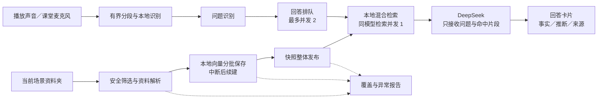

# Classbot 系统架构审计（2026-10-15 开始）

更新时间：2026-10-16。审计对象是整条桌面问答链路。QKD 资料库只作为大型混合资料的压力样本；索引策略、资源控制和错误处理均面向任意场景，不按资料库名称分支。

后续进展：真实全库已完成并由原 CPU 环境重载，当前为 4,934 文件、280,788 个 512 维
片段，容量遗漏 0。长文本编码尾部覆盖、精确文本向量复用、可读文本误拒、空片段发布、
重复路径校验与提交后恢复状态清理的发现和修复，见
[索引验证记录](verification-2026-10-16-index-engine.md)。实际播放音频与真实 DeepSeek
链路的成功、失败、修复及逐句来源审读另见
[实播验证记录](verification-2026-10-16-live-defense.md)。下文保留初轮审计当时的证据；
其中“本轮未计算完整向量”等历史边界不能当作当前全库状态。

后续实播陆续修复：答辩思考预算与课堂配置耦合、SSE 多层生成器未及时释放、
修订/取消后的回答流收尾、旧话题稀释新问题、混合检索分数尺度压掉强字面依据、
缺失章节主语导致限制归错模型，以及短暂停顿拆开复合提问。修复均使用通用领域
规则，未添加 QKD 专名纠错或指定文件加分。最新联合回归为 1,039 通过、3 跳过，
实际内容验收仍以实播记录中的逐卡来源审读为准。

来源编号正确仍不能证明一句话受到原文支持。多轮自由文本实播反复暴露主体及范围
迁移后，生产答辩改为单请求结构化事实：只发送当前问题和同批候选，把原文无损编为
单元，模型选择单元，本机回填引文、校验并组装答案；没有未受约束的首段或总结。
格式/未知单元/截断均零正文发布，缺证据接口的答辩适配器也明确失败，不能退回自由
回答。详情见 [证据回答决定](adr/0002-proof-bound-defense.md)。该本地校验仍不等于
自动证明语义，真实受控题必须逐句审读；没有引入项目专名规则。

最终受控实播记录：完整真实资料库 `run-11` 的四题、五张最终卡通过严格来源及
未校验正文零发布门槛，11 条事实分别得到原文支持；域外题保持零事实与不足提示。
三张卡实际状态为 `partial`，不事后改为 `supported`；其本地范围提示已单独修正并
用原 JSON 离线重组核对，模型结论、状态和引文未变。独立报名服务的 Word、Python、
CSV 场景 `general/run-02` 又以最新生产代码完成一张复合卡、三条事实的跨资料库验证。
全部实播资源均已释放，配置和原资料未改；受控 TTS 不等于实际钉钉/腾讯会议的噪声
或专业词准确率测试。当前可复核收据与限制见上述实播文档。

## 范围与证据边界

当前链路：Windows 播放声音／课堂麦克风 → 分段 → FunASR → 问题检测 → 场景内本地混合检索与 BGE 向量 → DeepSeek 接收问题及命中候选片段 → PySide6 卡片。



所有场景共用这条链路；报告用于解释覆盖和异常，不进入回答事实。图中的有界分段与识别已修复，课堂麦克风入口仍有下文单列的过载限制。

代码审查与回归测试使用合成文本、音频帧、替代模型与模拟 HTTP；集成主流程另对用户指定大型资料目录进行了只读扫描与解析，汇总如下。本轮未读取 `.env`、采集实际音频、调用云端回答模型；原始材料保持不变。已通过 `ScenarioStore` 将已有选中场景的 `index_mode` 升级为 `full`，保留原有 1 个场景的其他设置。单元测试与合成压力测试不能证明真实播放设备、课堂识别准确率、云端答案质量或原生窗口端到端体验。

“完整索引”指安全筛选后、当前解析器支持的材料覆盖策略。隐藏目录、依赖目录、敏感路径及不支持格式仍会排除；扫描 PDF 未经 OCR 不会因此变成可检索文本。路径与文件类型筛选不等于内容级 DLP，不能保证任意普通文档内嵌入的凭据都会被识别。本轮未完成真实大型资料库的全量构建，不能把合成覆盖测试写成该资料库已完整就绪。

## 真实资料库的只读解析核验

已核对最终本地回执 `tmp/full-library-coverage.json`：完整策略的扫描与解析耗时约 193.61 秒，去重后支持文件快照 4,937 项、489,641,733 字节；成功解析 4,922 项，形成 279,804 个片段；容量受限 0 项，报告跳过 10,461 项，其中重复内容 4,778 项。完整策略允许通用生成／输出目录中的可解析资料，仅排除明确依赖目录等安全规则，不按项目名分支。跳过计数还包含排除目录、隐藏／敏感／不支持格式、空白或无法提取文本等诊断，不能解释为这些内容已纳入检索。

成功文件包括 JSON 3,853、Python 457、Markdown 270、文本 82、CSV 98、PDF 73、PPTX 12、DOCX 2 等。JSON 等数据文件数量较多，解析覆盖率不能代表检索结果直接支持项目事实的比例。

回执明确记录 `source_bytes_retained_in_scan=0`、`embeddings_computed=false`。因此这证明真实材料的解析覆盖与诊断已经跑通，**不代表已经计算 279,804 个本地向量、发布完整可用索引或完成真实实时问答**。

另外，本地回执 `tmp/real-resume-verification.json` 验证了真实离线 BGE 模型在**合成材料**上的恢复：66 个片段，写入 64 行后取消，重开只计算剩余 2 行，最终发布 66 行只读 `memmap`；检索首项定位到合成文件 `explanation.md · lines 1–1`，耗时约 22.06 秒，云端调用 0 次。这验证实际模型与恢复机制的配合，仍不代表真实大型资料库的全部向量已经计算。

## 已确认问题与处置

| 事项 | 触发与证据 | 状态及处置 |
| --- | --- | --- |
| ASR 队列丢失分段控制标记 | 原实现队列满后无差别删除队首；512 帧、结束标记、再输入 513 帧，标记数量从 1 变成 0。旧“满队列”测试只使用 32+32 帧，未覆盖上限。 | 已实现修复：抛出明确过载异常、固定队列容量、终止失真会话并允许重新开始；接受后的 PCM 与结束标记不再被静默替换。分项 ASR／分段／运行时／管线检查反馈 73 项通过；最终集成状态见后文。 |
| 持续讲话使音频状态无限增长 | 原分段只等待静音；即使关闭最终重解码，识别器仍保留整段浮点 PCM。长时间持续声音使内存、累计转写和最终重解码成本增长。 | 已实现修复：关闭重解码时不保留整段 PCM；分段增加默认 60 秒上限及连续段标记。连续段与管线预滚动已一并通过回归验证。 |
| 取消回答后检索线程继续占用资源 | `asyncio.to_thread(search)` 的等待者取消不会停止已经运行的本地线程；重复修订会在向量模型锁及词法扫描前积压。 | 已修复：真实检索工作完成前持有同模型共享许可，取消等待者不会提前放行；客户端关闭阻止后续请求；管线最多并发两项回答。工作区／资源／管线／运行时独立回归 71 项通过。 |
| 长查询的词法检索成本随资料量放大 | 原词法实现将全部查询二／三元字串逐个查找于全部片段；合成 2,000 个 1,200 字片段、800 字查询一次耗时 1.047 秒。问题检测器允许的问题与背景总长更大。 | 已修复：最多 64 个词法项，优先当前问题、保留完整代码标识符，背景项受限；使用字面模式预筛选后精确计算重叠。独立回归 42 项通过。该基线不是所有真实查询的时延，也不应外推为实时保证。 |
| 截断或空 SSE 被当作回答完成 | 原客户端只检查 `[DONE]`，忽略 `finish_reason=length/content_filter`；第二次空流正常返回，管线标记 answered。 | 客户端已实现不完整结束原因报错、保留已输出片段、不在已有输出后自动重试、空白／空回答耗尽重试时报错；分项客户端／管线检查反馈 59 项通过。 |
| 新建场景覆盖损坏配置的唯一原件 | 启动读取失败后内存场景列表为空；之后保存新场景会替换同一配置文件。原有“原文件已保留”提示只在再次保存前成立。 | 已修复：保存替换前检测现有配置；损坏原件按原始字节保存到同目录唯一 `scenarios.json.invalid-*.bak`，刷新落盘成功后才替换。备份失败则中止保存；`last_backup_path` 提供恢复路径，工作区会显示备份位置。损坏恢复行为只在测试临时目录验证；真实有效配置仅进行了上述索引策略升级。 |
| 对话框验证与场景模式不一致 | 对话框原来只检查名称非空；121 字名称可接受，随后场景类型构造抛异常并丢失编辑。 | 已修复：接受前使用 `ScenarioProfile` 同一规则验证，错误保持对话框打开并保留输入；类型、索引策略变更也即时验证。 |
| 索引覆盖策略缺少通用用户入口 | 原场景对话框无法选择完整／平衡策略。 | 已修复：新增通用完整／平衡选择；新场景默认完整，编辑保留已存选择，旧配置按既有 balanced 默认解析。完整模式仍受安全上限约束，达到上限须明确失败，不能宣称部分结果为完整。 |
| 场景切换保留旧的“当前问题”标题 | 场景和资料状态切换后，当前转写及问题标题仍显示上一场景内容。 | 已修复：切换场景清空实时转写、当前问题及其关联标识；原有带场景标签的历史卡片保留。 |
| 每个场景重复加载本地模型并保留所有索引 | 工作区长期持有访问过的索引；索引各自创建向量模型，场景增多会累积模型、文本和向量资源。 | 已修复：按模型身份共享本地模型和检索许可，最多保留最近 3 个场景索引；只释放引用，不关闭仍可能被工作线程使用的映射。模型身份在后台计算；资源及生命周期分项已验证。未对真实资料库进程峰值作测量。 |
| 取消与索引发布的提交时刻不一致 | 合成回放在“提交完整资料快照”进度回调中设置取消；旧快照仍被替换、恢复状态被删除，最终却抛出取消异常。大型元数据序列化期间的取消也存在同类窗口。 | 已修复并独立复核：临时元数据准备、刷新落盘后，原子替换前检查取消；成功提交后立即收到取消仍返回成功。 |
| 本地模型的同大小、同时间替换不改变身份 | 原本地模型身份只有文件名、大小和修改时间；保留这些元数据替换权重后，合成新旧模型仍得到相同身份和索引版本，旧向量被复用。恢复构建也可能混用模型。 | 已修复并独立复核：本地模型身份加入文件内容摘要，模型身份计算移至后台，避免读取大权重阻塞 UI。 |
| 恢复进度未绑定实际解析片段 | 真实 PDF 解析器差异回放：同一合成 PDF 用 pypdf 得到先写入的下行在前，PyMuPDF 排序得到上行在前；分段数相同。第一次完成向量后中断，再换后端恢复，旧向量被配给新顺序文本。 | 已修复并独立复核：恢复身份包含实际路径、定位及文本的有序摘要；解析器身份包含相关包版本，不再只靠源文件版本和片段数恢复。 |
| Windows 映射仍打开时旧向量文件无法删除 | 刷新发布新快照时，工作区仍可能持有旧映射；Windows 拒绝删除该文件，单纯捕获错误会令旧文件长期累积。 | 已修复并独立复核：构建锁内、提交成功后，仅清理当前索引精确命名且无人引用的自有向量文件；保留当前快照与恢复状态引用，引用不可信时停止清理，跳过链接及重解析点。仍被 Windows 映射占用的文件保留，之后成功发布时再尝试；不强行关闭工作线程仍可能使用的映射。 |
| Qt 退出早于索引工作线程结束 | 关闭窗口只取消等待任务时，后台原生工作仍可能执行；如果事件循环先退出，取消后的收尾无法正常完成。外部 Qt 退出也必须执行同样收尾。 | 已修复：工作区异步关闭等待合作式取消及任务收尾，运行时在最终退出判断之前调用资源收尾。真实 qasync 主入口的普通关窗与外部退出离屏回放均确认工作线程先结束，再退出 Qt；音频设备和云端调用均为 0。 |

## UI 与配置的回归验证

先加入回归测试，在工作区独立临时目录观察到 12 项按预期失败、9 项通过；实现后，以下范围 78 项通过：

```powershell
$env:PYTEST_DISABLE_PLUGIN_AUTOLOAD='1'
$env:QT_QPA_PLATFORM='offscreen'
.\.venv\Scripts\python.exe -B -u -m pytest tests\test_scenarios.py tests\test_scenariosfull.py tests\test_architecture_ui.py tests\test_defense_ui.py tests\test_main_window.py tests\test_index_report_ui.py -q -p pytest_asyncio.plugin -p no:cacheprovider --basetemp tmp\audit-ui-final-20261016 --tb=short
```

验证涵盖损坏 JSON、无效 UTF-8、未知配置格式的逐字节备份，备份创建失败保留原件，连续损坏产生不同恢复副本，有效配置不产生多余副本，名称及类型验证，新增／编辑索引策略，切换场景清空实时标题并保留标记历史。所改 UI／配置文件及相关测试的 Ruff 检查通过。

独立复核还完成：词法预算及紧凑存储 42 项通过；完整策略／恢复批次／向量存储 57 项通过；工作区／资源／管线／运行时 71 项通过。三项恢复／提交新问题的定向回归 4 项通过，另用原子替换成功后立即取消的回放确认提交状态一致。这些分项存在交叉，不相加为整套测试数量。

向量遗留文件清理独立回归 19 项通过、2 项因沙箱链接权限跳过；Windows 实际映射的“占用时保留、关闭后删除”分项回放通过。未对真实用户缓存执行清理实验。

最终功能代码联合检查得到 **572 项通过、2 项跳过，耗时 39.79 秒**；`src` 与 `tests` 的 Ruff 检查通过，`git diff --check` 通过。跳过项属于链接能力受限的检查，不能写成这些路径已在当前受限环境全部验证。

已独立查看 `tmp/scenario-full-preview.png` 的离屏 Qt 预览，完整策略选项、中文和按钮可见且没有重叠；此项不等于实际监听窗口的现场体验核验。本地 `tmp/qt-shutdown-verification.json` 与 `tmp/qt-shutdown-external-verification.json` 还记录真实 qasync 主入口的离屏关闭回放：普通关窗及外部退出时，合作式工作线程均在 Qt 退出前完成收尾，没有打开音频设备或调用云端。

默认系统临时目录在本次受限环境中曾使既有 `os.replace` 测试触发 WinError 5；改用工作区独立测试目录后获得上述有效失败与通过证据。没有因此改变产品的原子替换语义。

受限 Windows 环境的 `asyncio` 本地 socketpair 初始化会挂起；涉及异步运行时的独立回归经自动审核批准后在沙箱外执行，仍只使用合成替代对象及工作区测试目录。该环境差异没有被当作产品测试通过或失败。

## 仍需验证或后续处理

1. **检索相关性与无依据回答。** 当前正分候选不等于直接证据。系统提示及卡片已有候选含义说明，本轮未发现可证明必然发生的跨场景云端泄露，但这不能替代证据支持率评估。应加入无关问题、否定前提、多子问及代码标识符等通用题集；不要用未经标定的固定余弦阈值宣布解决幻觉。
2. **课堂麦克风入口的过载语义。** `AudioCapture` 仍按每帧调度主循环回调、队列满时删除旧帧，与播放声音入口的有界合并唤醒／显式过载不同。答辩播放声音路径使用后者；课堂麦克风在 UI 长时间阻塞时的连续性仍需单独修复及回放验证。
3. **真实端到端体验。** 本轮没有进行真实播放设备断连／切换、持续讲话、暂停重开、云端限流或用户窗口观察。自动测试通过不得写成已经完成这些验证。
4. **真实大型资料库的完整向量。** 全量策略传递、可恢复批次、合作式取消、快照发布、模型共享、索引保留上限及旧向量清理已通过上述代码检查；真实资料库全部本地向量仍未计算完成。解析覆盖、66 个合成片段的真实模型恢复与完整资料库就绪是三种不同证据。

## 小范围架构方向

- **音频入口 Module**：统一控制标记、过载、连续段、唤醒容量和恢复状态的 Interface，避免各个入口分别解释“有界队列”。
- **回答调度 Module**：在一个 Seam 集中持有问题版本、排队、真实检索工作的许可及 HTTP 并发上限；取消 UI 等待不能被解释为底层工作已经停止。
- **工作区资源 Module**：以不可变模型身份共享本地模型，限制非活动索引，固定当前会话的场景和快照。这样提高故障及资源策略的 locality，同时保持检索和卡片 Interface 简单。

上述方向用于集中已确认的跨模块规则，不要求推倒当前管线重写。
